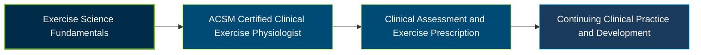

# ACSM Certified Clinical Exercise Physiologist Certification Exam Guide

A dedicated study guide and clinical exercise science reference repository for candidates preparing for the **ACSM Certified Clinical Exercise Physiologist (ACSM-CEP) Certification Exam**, covering patient assessment, exercise testing, clinical exercise prescription, and risk management.

---

## Exam Overview

The ACSM Certified Clinical Exercise Physiologist certification validates the knowledge and skills needed to prescribe and supervise exercise for people with chronic diseases and other medically complex conditions.

- **Exam Format**: Multiple-choice, proctored exam available online or at a Pearson testing center.
- **Target Audience**: Clinical exercise physiologists and qualified exercise science professionals working with patients who have chronic health conditions.
- **Prerequisites**: A master's degree in Clinical Exercise Physiology or equivalent plus 600 hours of hands-on clinical experience, or a bachelor's degree in Exercise Science, Exercise Physiology, or equivalent plus 1,200 clinical hours; also requires Basic Life Support or CPR for the Professional Rescuer certification.

---

## Core Exam Domains & Knowledge Areas

### 1. Patient Assessment

- Review medical records, health history, medications, and physician referrals.
- Assess vital signs, clinical status, risk factors, and exercise readiness.
- Determine appropriate monitoring and supervision based on patient needs.

### 2. Exercise Testing

- Select appropriate exercise tests and protocols based on clinical status.
- Monitor physiological responses, symptoms, ECG findings, and test safety.
- Interpret test results to inform exercise prescription and patient care.

### 3. Exercise Prescription

- Develop individualized exercise prescriptions for chronic diseases and conditions.
- Apply FITT principles and account for medications, limitations, and clinical needs.
- Adjust exercise programs according to patient response and progress.

### 4. Exercise Training and Leadership

- Implement and supervise safe, disease-specific exercise training.
- Communicate exercise plans and demonstrate appropriate techniques.
- Monitor patient responses and adapt training when needed.

### 5. Education and Behavior Change

- Apply patient-centered counseling and behavior-change strategies.
- Address barriers to participation, motivation, and exercise adherence.
- Educate patients on physical activity, self-management, and healthy behaviors.

### 6. Legal and Professional Responsibilities

- Follow professional ethics, scope of practice, and applicable regulations.
- Maintain appropriate documentation, confidentiality, and patient records.
- Apply emergency response, safety, and risk-management procedures.

---

## Certification Path

This diagram represents a suggested professional learning progression, not an official ACSM certification ladder.

---

## Recommended Practice & Study Resources

Use the current ACSM exam outline as the foundation for study, then reinforce clinical reasoning through structured review and practical application.

- **CertsGate**: Explore [ACSM 030-444 exam preparation resources](https://certsgate.com/exams/acsm/030-444) for supplementary study materials and practice questions.
- **Practical Study**: Review patient assessment, exercise testing, disease-specific exercise prescription, clinical monitoring, and emergency procedures using current ACSM guidance and appropriate supervised clinical scenarios.
